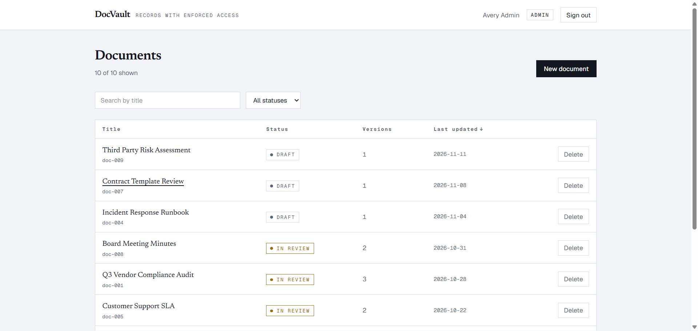
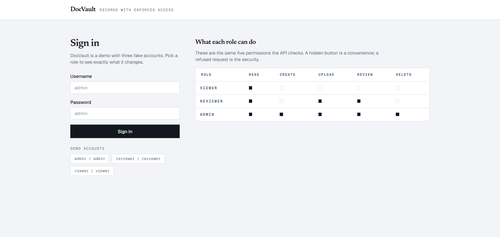
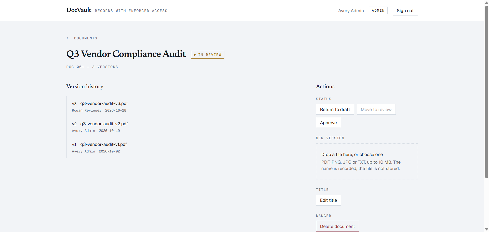

# DocVault

Document management app with role-based access control enforced on **both** the UI and the API.

**Live demo:** https://docvault-blond-rho.vercel.app
**Test logins:** `admin / admin` · `reviewer / reviewer` · `viewer / viewer` — the login page has one-click buttons for each, and a live matrix showing exactly what that role can do.



## What it does

- 3 roles (admin / reviewer / viewer) with 5 permissions, enforced in the route handlers **and** mirrored in the UI
- Document register with search, status filter and sortable columns
- Version history per document, with a status change only reviewers and admins can make
- Validated forms and uploads (Zod on the client, re-validated on the server)
- Loading, empty and error states on every data screen
- A "check with the server" button that asks the API for its verdict without changing anything, so you can watch a `403` happen



## The permissions

One matrix in `src/lib/permissions.ts` is the single source of truth. The UI reads it to hide controls; every route handler reads it to refuse the request.

| Permission | viewer | reviewer | admin |
| --- | :---: | :---: | :---: |
| `doc:read` | ● | ● | ● |
| `doc:create` | | | ● |
| `doc:upload` | | ● | ● |
| `doc:review` | | ● | ● |
| `doc:delete` | | | ● |

`PATCH /api/documents/:id` checks **per field**, so one request can need more than one permission:

```ts
const required: Permission[] = [];
if (patch.title !== undefined) required.push('doc:create');
if (patch.status !== undefined) required.push('doc:review');
if (patch.fileName !== undefined) required.push('doc:upload');

const denied = required.find((permission) => !can(user.role, permission));
if (denied) return NextResponse.json({ error: DENIAL_MESSAGES[denied] }, { status: 403 });
```

A UI check is a convenience. The handler check is the security. The detail page's **Check with the server** button exists to make that difference visible: as a viewer it comes back `403 — Only a reviewer or admin can change the status`.



## Stack

Next.js 16 (App Router) · React 19 · TypeScript · Tailwind CSS v4 · Zustand · Zod · Vitest · Testing Library · GitHub Actions · Vercel

## Running it

```bash
npm install
npm run dev      # http://localhost:3000
npm test         # vitest
npm run typecheck
npm run lint
npm run build
```

Sign in with any of the three demo accounts. Each one sees a different app.

## Project layout

```
src/
  app/
    login/page.tsx           sign in, with the live permission matrix
    documents/page.tsx       the register
    documents/[id]/page.tsx  one document
    api/
      auth/route.ts          POST sign in, DELETE sign out
      documents/route.ts     GET list, POST create
      documents/[id]/route.ts GET, PATCH, DELETE
  components/                RoleGate, StatusBadge, DocumentTable, DocumentForm,
                             UploadDropzone, DocumentDetail, states/
  lib/
    permissions.ts           the matrix and can()
    auth.ts                  cookie session (server-only)
    mockDb.ts                in-memory store (server-only)
    schemas.ts               Zod schemas
  proxy.ts                   route guard (Next 16 renamed middleware to proxy)
  store/useAuthStore.ts      Zustand
```

## Decisions I made

**One matrix, two enforcement points.** `can()` is the only place a role maps to a permission, so the button you cannot see and the request you cannot make can never disagree. I deliberately did not write the check twice.

**Permissions are checked per field, not per route.** A `PATCH` can carry a title, a status and a new version at once, and those need three different permissions. Checking the route instead of the payload would have meant one blunt "you may not edit this" for a user who is allowed to do most of it.

**Next 16 renamed `middleware` to `proxy`.** The route guard is `src/proxy.ts`, and it only checks for the presence of the session cookie. It is deliberately not the security boundary: every route handler re-reads the cookie and re-checks the matrix, because a page-level check never covers a direct call to the API.

## Bugs I hit

**The production build died on `/_not-found`.** The root layout reads the session cookie, and with Cache Components on, a request-time read cannot be prerendered into the static shell — so the build failed on the not-found route, not on mine. The fix was `export const instant = false` on the layout, which is the documented way to keep blocking on the server for an app that reads a session. The alternative was streaming the header behind a `<Suspense>` boundary, which is the better long-term shape.

**React's own lint rule rejected my data fetching.** `react-hooks/set-state-in-effect` fired on `useEffect(() => { void load() })` even though `load()` awaited before it touched state — the rule works on the compiler's intermediate representation, and it inlines local closures into the effect body. Moving the fetch into module-scope helpers and handling the result in a `.then()` callback satisfied the rule and is the same unmount-safe pattern either way.

**Vitest would not install.** The scaffold pins `@types/node@^20`, and Vitest 5 wants `^22 || ^24`. Rather than reach for `--legacy-peer-deps`, I bumped the types to match the Node version the project actually runs on.

## What I would improve

- **Real authentication.** The demo credentials ship in the client bundle and are compared in a route handler. This should be a password hash and an httpOnly signed session, or an identity provider.
- **A real database.** The store is an in-memory array. On a serverless host each instance gets its own copy, so a document created in one request may not be visible in the next. That is a deliberate limitation of the mock, not a bug, but it is the first thing I would replace with Postgres.
- **Real file storage.** Only the file name and size are recorded; the bytes never leave the browser. The upload would go to object storage with a signed URL.
- **Audit trail.** A reviewer changing a status should leave a record of who changed it and when, not just a version number.
- **Rate limiting and CSRF tokens** on the write endpoints.

## Licence

MIT
